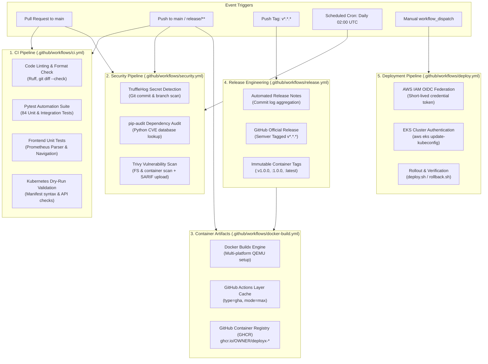

# DeployX — CI/CD Pipeline & Automation Architecture

Welcome to the **DeployX Continuous Integration & Continuous Delivery (CI/CD)** documentation. This directory houses the production-grade GitHub Actions workflows governing code quality, vulnerability analysis, automated testing, container artifact creation, release engineering, and cloud deployment.

---

## 🏗️ Architecture & Pipeline Lifecycle

The DeployX CI/CD architecture is built on a modular, event-driven pattern designed for fast developer feedback loops, strict supply chain security, and zero-downtime deployment safety.



---

## 📂 Workflow Matrix & Specification

The platform utilizes 5 specialized workflows located in `.github/workflows/`:

| Workflow File | Primary Triggers | Concurrency Group | Minimum Permissions | Primary Responsibilities |
|---|---|---|---|---|
| [`ci.yml`](workflows/ci.yml) | `push` (`main`, `release/**`), `pull_request`, `workflow_dispatch` | `ci-${{ github.workflow }}-${{ github.ref }}` | `contents: read` | Parallel execution of Ruff linting, formatting checks, git diff validation, 84-test Pytest suite, Node.js frontend tests, and Kubernetes manifest dry-run validation. |
| [`docker-build.yml`](workflows/docker-build.yml) | `push` (`main`, `tags: v*.*.*`), `pull_request`, `workflow_dispatch` | `docker-${{ github.workflow }}-${{ github.ref }}` | `contents: read`, `packages: write` | Multi-stage Docker Buildx image builds for backend and frontend with GitHub Actions layer caching (`type=gha`). Untrusted PRs build only; push to GHCR is strictly gated to `main` and semver tags. |
| [`security.yml`](workflows/security.yml) | `push` (`main`), `pull_request`, `schedule` (Daily 02:00 UTC), `workflow_dispatch` | `security-${{ github.workflow }}-${{ github.ref }}` | `contents: read`, `security-events: write` | High-assurance security gating: TruffleHog deep secret leak detection, `pip-audit` automated CVE dependency evaluation, and Trivy container vulnerability scanning with GitHub Security SARIF reporting. |
| [`release.yml`](workflows/release.yml) | `push` (Tags `v*.*.*`), `workflow_dispatch` | `release-${{ github.ref }}` | `contents: write`, `packages: write` | Generates official GitHub Releases with automated changelogs, builds multi-architecture production images, tags immutable semver versions on GHCR, and attaches release assets. |
| [`deploy.yml`](workflows/deploy.yml) | `workflow_dispatch` (Manual with Environment/Color inputs) | `deploy-${{ github.workflow }}-${{ github.event.inputs.target_environment }}` | `contents: read`, `id-token: write` | Production-ready CD skeleton for AWS EKS (Phase 9 integration) utilizing AWS OIDC authentication, zero-secret credential assumption, and execution of verified automation scripts. |

---

## 🛡️ Security, Governance & Supply Chain Best Practices

### 1. Immutable Action Pinning to 40-Character Commit SHAs
To protect against supply chain compromises and tag mutations in third-party GitHub Actions, all external actions are pinned directly to immutable commit SHAs with inline version comments:

```yaml
- name: Checkout Repository
  uses: actions/checkout@11bd71901bbe5b1630ceea73d27597364c9af683 # v4.2.2

- name: Set up Docker Buildx
  uses: docker/setup-buildx-action@b5ca514318bd6ebac0fb2aedd5d36ec1b5c232a2 # v3.10.0

- name: Log in to GitHub Container Registry
  uses: docker/login-action@9780b0c442fbb1117ed29e0efdff1e18412f7567 # v3.3.0
```

### 2. Principle of Least Privilege (PoLP)
Every workflow specifies explicit top-level `permissions` set to `contents: read`. Elevated capabilities are granted on a strict per-job basis:
- **Image Publishing (`docker-build.yml`, `release.yml`):** `packages: write` (required only for pushing to GHCR).
- **Security Reports (`security.yml`):** `security-events: write` (required only for uploading Trivy SARIF results to GitHub Security tab).
- **Cloud CD (`deploy.yml`):** `id-token: write` (required only for AWS STS OIDC web identity token exchange).

### 3. Isolation of Untrusted Pull Requests
Pull request events from forks or external contributors are executed with read-only tokens:
- **No Image Publishing:** The `push` parameter in `docker/build-push-action` evaluates:
  ```yaml
  push: ${{ github.event_name != 'pull_request' }}
  ```
- **No Secret Access:** Workflows never pass sensitive secrets or write credentials to PR jobs.

### 4. Zero Hardcoded Credentials & OIDC Federation
- Workflows contain **zero hardcoded tokens, passwords, or AWS access keys**.
- The deployment workflow (`deploy.yml`) is architected for **OpenID Connect (OIDC)** authentication with AWS IAM (`aws-actions/configure-aws-credentials`). This eliminates long-lived IAM access keys by exchanging ephemeral JWT tokens directly with AWS STS.

---

## 📦 Container Registry Architecture (GHCR)

DeployX packages and distributes multi-container artifacts through GitHub Packages (GHCR):

### 1. Image Registry Paths
- **Backend Application:** `ghcr.io/<owner>/deployx-backend`
- **Frontend Dashboard:** `ghcr.io/<owner>/deployx-frontend`

> *Note:* Repository owners are automatically transformed to lowercase using `docker/metadata-action` to ensure compliance with Docker image naming standards.

### 2. Image Tagging Scheme
| Event / Ref | Generated Tags | Purpose |
|---|---|---|
| Push to `main` | `:main`, `:main-<short_sha>` | Continuous deployment testing and latest mainline tracking |
| Pull Request | `:pr-<number>` | Local build and layer validation only (never pushed to remote) |
| Git Tag `v1.2.0` | `:v1.2.0`, `:1.2.0`, `:latest` | Immutable production release versioning |

### 3. Layer Caching Optimization
To reduce CI runner build durations from minutes to seconds, Buildx utilizes GitHub Actions cache backend:
```yaml
cache-from: type=gha,scope=${{ matrix.image }}
cache-to: type=gha,mode=max,scope=${{ matrix.image }}
```

---

## 💻 Local Developer Pre-Flight Validation

Before pushing code or opening a Pull Request, developers can run identical local verification steps to guarantee green CI checks:

```bash
# 1. Python Code Quality & Formatting
ruff check backend/ tests/ frontend/
ruff format --check backend/ tests/ frontend/
git diff --check

# 2. Automated Test Suite (84 Tests)
pytest -v backend/tests/ tests/

# 3. Frontend Unit & Navigation Tests
node frontend/test_api_parser.js
node frontend/test_navigation.js

# 4. Kubernetes Manifest Dry-Run Validation
kubectl apply --dry-run=client -f infrastructure/kubernetes/
kubectl apply --dry-run=client -f infrastructure/monitoring/

# 5. Dependency Vulnerability Audit
pip-audit -r backend/requirements.txt

# 6. Local Container Build Verification
docker build -t deployx-backend:local -f infrastructure/docker/backend.Dockerfile .
docker build -t deployx-frontend:local -f infrastructure/docker/frontend.Dockerfile .
```

---

## 🔧 Operational Troubleshooting

### Problem: `Error: Resource not accessible by integration`
- **Cause:** Missing explicit permission block in the workflow file.
- **Remedy:** Ensure the target job or workflow specifies the required permission (e.g., `packages: write` for GHCR or `security-events: write` for SARIF uploads).

### Problem: `docker/build-push-action: denied: installation not allowed to Create organization package`
- **Cause:** Repository settings do not have GitHub Container Registry package read/write permissions enabled for GitHub Actions.
- **Remedy:** Navigate to **Repository Settings** $\rightarrow$ **Actions** $\rightarrow$ **General** $\rightarrow$ **Workflow permissions** and select **"Read and write permissions"**.

### Problem: `pip-audit: Found 1 known vulnerability`
- **Cause:** An upstream dependency in `backend/requirements.txt` has an active CVE advisory.
- **Remedy:** Inspect the pip-audit terminal report, locate the patched version in PyPI/CVE advisory, update the version constraint in `backend/requirements.txt`, run `pip install -r backend/requirements.txt && pip-audit -r backend/requirements.txt`, and verify all tests pass.

### Problem: Action commit SHA validation error in `tests/test_ci_cd.py`
- **Cause:** A third-party action was added using a floating tag (e.g. `@v4`) rather than an immutable 40-character commit SHA.
- **Remedy:** Look up the exact commit SHA for the released action release tag on GitHub, update the workflow reference to `<action>@<40-char-sha> # vX.Y.Z`, and re-run `pytest tests/test_ci_cd.py`.
