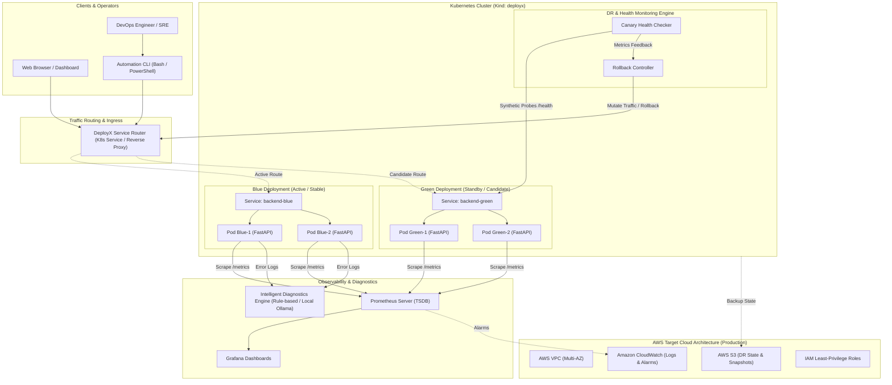

# DeployX – Architecture Specification Document

**Project:** DeployX – Intelligent Cloud Deployment & Disaster Recovery Platform
**Author:** Senior DevOps Engineer & AWS Cloud Architect
**Version:** 1.0.0-draft
**Target Environments:** Local Kubernetes (Kind / Docker) & Target Cloud (AWS)

---

## 1. System Overview & Engineering Objectives

DeployX is a portfolio-grade cloud deployment, traffic orchestration, and automated disaster recovery platform designed to demonstrate modern DevOps engineering principles. The platform enables zero-downtime blue-green deployments, continuous canary health probing, automated disaster recovery rollbacks upon SLA violations, full-stack observability with Prometheus and Grafana, and intelligent incident diagnostics.

### Core Objectives:
1. **Zero-Downtime Blue-Green Deployment:** Coordinate active and standby release channels with instant traffic switching.
2. **Automated Disaster Recovery (DR) Rollback:** Detect degraded latency or error anomalies during deployment cutover and automatically revert traffic to the stable release.
3. **Resource Efficiency & Lightweight Footprint:** Architected specifically to operate reliably within a constrained local compute envelope (~3.5 GiB RAM in WSL2/Docker).
4. **Cloud-Native Observability:** Expose granular RED metrics (Rate, Errors, Duration) via Prometheus and provide real-time dashboards in Grafana.
5. **Cross-Platform DevOps Automation:** Provide native, parity-tested automation scripts for both Linux (Bash) and Windows (PowerShell).
6. **AWS Production-Ready Blueprints:** Model production cloud topology incorporating multi-AZ VPC, IAM least privilege, S3 disaster recovery snapshots, and CloudWatch alerting.
7. **Cost Zero Dependency:** Completely operational offline without any paid external cloud or proprietary API dependencies.

---

## 2. High-Level Architecture Diagram



---

## 3. Subsystem Architecture

### 3.1 Backend Service (FastAPI)
The core backend application is built using FastAPI on Python 3.14+, structured for maintainability and minimal memory usage:
- **Modular Directory Architecture:**
  - `backend/app/main.py`: Application entrypoint and lifecycle events.
  - `backend/app/core/config.py`: Strict environment-driven settings using Pydantic.
  - `backend/app/core/logging.py`: Structured JSON logger with contextual request IDs.
  - `backend/app/api/v1/`: API endpoints segregated by domain (`health`, `deployment`, `diagnostics`, `metrics`).
- **Telemetry & Health Probes:**
  - `/health/live`: Lightweight liveness check (is the event loop responsive?).
  - `/health/ready`: Readiness check (are upstream components and memory healthy?).
  - `/health`: Detailed diagnostic state (uptime, version, active color, CPU/RAM utilization).
  - `/metrics`: Prometheus-formatted metrics generated via `prometheus_client`.
- **Chaos Injection Capabilities:**
  - Endpoints to simulate high latency, synthetic 500 error spikes, or memory consumption to validate the disaster recovery rollback engine during chaos testing.

### 3.2 Frontend Dashboard (Lightweight SPA)
- Zero heavy compilation dependencies (no heavy Node.js bundle overhead in memory).
- Clean, responsive HTML5/CSS3/Vanilla JS single-page application served via an Alpine Nginx container.
- Displays real-time cluster health, current active deployment color (Blue/Green), traffic transition progress, and instant manual failover controls.

### 3.3 Blue-Green Deployment & Disaster Recovery Engine
The deployment engine implements zero-downtime releases and automated rollback:
1. **Baseline State:** Active traffic routes to the **Blue** deployment (`deployx-backend-blue`).
2. **Candidate Deployment:** The **Green** deployment (`deployx-backend-green`) is launched with candidate configuration and images.
3. **Canary Validation:** The synthetic canary prober runs sequential health checks against Green's isolated service (`/health/ready`).
4. **Traffic Flip:** If Green passes all health checks (e.g., 3 consecutive 200 OK responses with latency < 100ms), the traffic router shifts traffic from Blue to Green by updating the Kubernetes Service selector (`role=green`).
5. **Continuous SLA Watchdog:** The rollback controller monitors error rates and latency post-shift.
6. **Automated Rollback Trigger:** If error rate exceeds 5% or latency exceeds 500ms within the observation window, the controller immediately reverts the service selector back to Blue (`role=blue`) and logs an incident event.

### 3.4 Observability Subsystem
- **Prometheus:** Configured with a lightweight scrape interval (15s) and 6-hour retention policy to respect the 3.5 GiB memory ceiling. Collects:
  - HTTP request count by status code and endpoint
  - HTTP request duration histograms (p50, p95, p99)
  - Active deployment color gauge (`deployx_active_color{color="blue|green"}`)
  - Disaster recovery trigger counter (`deployx_rollback_events_total`)
- **Grafana:** Pre-provisioned with custom dashboards rendering:
  - Blue vs. Green traffic split
  - Real-time error rate vs. rollback threshold
  - Pod CPU & Memory consumption
  - Deployment transition history

### 3.5 Intelligent Diagnostics Subsystem
- **Deterministic Rule-Based Engine:** Rapidly analyzes Kubernetes events and container logs for known failure signatures:
  - `CrashLoopBackOff` (identifies exit code 1, missing environment variables, or unmet dependencies)
  - `OOMKilled` (identifies memory threshold breach and recommends limit adjustments)
  - `ImagePullBackOff` / `ErrImagePull` (identifies registry or tag mismatches)
  - `Unhealthy` / probe timeouts
- **Optional Local LLM (Ollama):** If an operator has a local Ollama instance running, DeployX routes log snippets to `mistral` or `llama3` for natural language root-cause analysis and remediation steps. If Ollama is offline or unavailable, DeployX seamlessly falls back to the rule-based engine without failure.

---

## 4. Local Kubernetes Architecture (Kind)

The local cluster is deployed using Kind (`kind-deployx` on Kubernetes v1.34.0):
- **Namespace:** `deployx`
- **ConfigMaps:** `deployx-config` containing application environment variables.
- **Secrets:** `deployx-secrets` containing encrypted/base64 tokens and keys.
- **Blue Deployment:** 2 replicas of `deployx-backend:blue`.
- **Green Deployment:** 2 replicas of `deployx-backend:green`.
- **Active Service:** `deployx-service` (Service selector dynamically points to `version: blue` or `version: green`).
- **Direct Services:** `deployx-blue-service` and `deployx-green-service` for direct canary probing.
- **Local Ingress / Port Forward:** Mapped to localhost for operator testing.

---

## 5. AWS Cloud Architecture (Production Target)

For production deployment, the platform is architected for high availability and disaster recovery across AWS:
- **VPC & Networking:** Custom VPC (`10.0.0.0/16`) spanning 2 Availability Zones (`us-east-1a`, `us-east-1b`) with public and private subnets, Internet Gateway, and NAT Gateway.
- **Compute Layer:** Amazon Elastic Kubernetes Service (EKS) or Auto-Scaling EC2 instances with launch templates running containerized workloads.
- **Load Balancing:** AWS Application Load Balancer (ALB) with weighted target groups enabling blue-green traffic splits and canary routing.
- **Disaster Recovery Storage (S3):** S3 bucket with versioning, cross-region replication (CRR), and lifecycle rules for database dumps and deployment state snapshots.
- **Security & IAM:** IAM roles for service accounts (IRSA) enforcing least privilege; AWS Secrets Manager for secret lifecycle.
- **Monitoring & Alarms:** Amazon CloudWatch metrics, custom metric filters for 5xx errors, and CloudWatch Alarms triggering automated rollback via SNS/Lambda.

---

## 6. Resource Budget & Memory Sizing Analysis

Given the verified host environment with **3.5 GiB total RAM in WSL2** and **2.2 GiB currently available**, all components are allocated strict resource ceilings:

```text
Total Available Working Memory: ~2,250 MiB
------------------------------------------------------------
Component                     Replicas    Memory Limit    Total
------------------------------------------------------------
FastAPI Backend (Blue)           2          128 MiB      256 MiB
FastAPI Backend (Green)          2          128 MiB      256 MiB
Frontend Dashboard (Nginx)       1           64 MiB       64 MiB
Prometheus Server (TSDB)         1          256 MiB      256 MiB
Grafana Visualizer               1          128 MiB      128 MiB
------------------------------------------------------------
Total Workload Allocation:                               960 MiB
Safety Buffer (OS, Kind, Docker cache):                1,290 MiB
------------------------------------------------------------
```
This guarantees system stability and completely prevents host thrashing or Kubernetes `OOMKilled` pod evictions.

---

## 7. Security & Compliance Posture

1. **Non-Root Execution:** All Docker containers run as an unprivileged user (`deployx:10001`).
2. **Read-Only Root Filesystems:** Container file systems are set to read-only where possible, with `/tmp` mounted as ephemeral `tmpfs`.
3. **Secret Hygiene:** Zero plain-text credentials in Git. All secrets injected via environment variables or Kubernetes Secrets.
4. **Network Policies:** Kubernetes network policies restrict inter-pod communication so only the traffic router can reach the backend pods directly.
5. **Linting & Vulnerability Scanning:** Integrated Trivy and Ruff scans in CI/CD pipeline.
