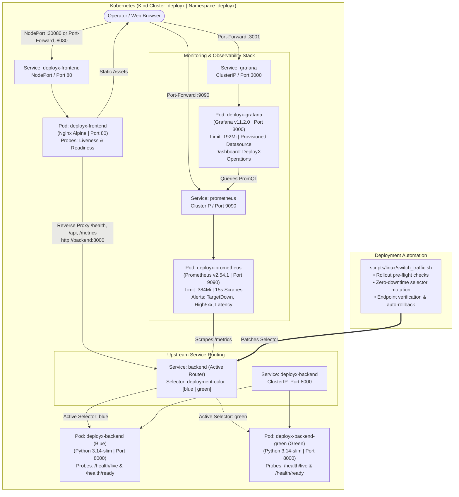
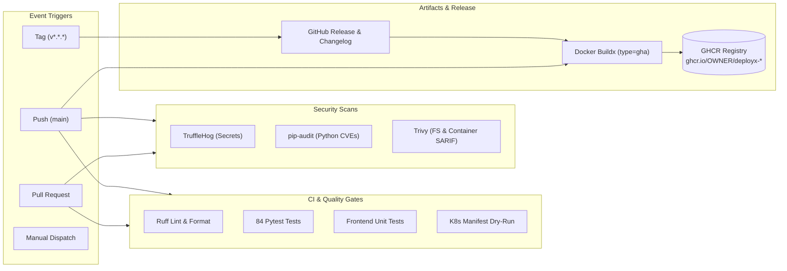

# DeployX – Intelligent Cloud Deployment & Disaster Recovery Platform

[](https://kubernetes.io/)
[](https://www.docker.com/)
[](https://kind.sigs.k8s.io/)
[](https://fastapi.tiangolo.com/)
[](https://prometheus.io/)
[](https://grafana.com/)
[](tests/)
[](LICENSE)

> **DeployX** is a modular cloud deployment, telemetry, and disaster recovery platform engineered to demonstrate modern containerization, Kubernetes orchestration, telemetry, high-availability operations, cross-platform automation, enterprise CI/CD automation, and production-grade AWS cloud infrastructure. The platform features a production-hardened FastAPI backend with health and readiness endpoints, Prometheus-format application metrics, a responsive HTML/CSS/JavaScript operations dashboard, containerization via Docker and Docker Compose, a local Kubernetes deployment using Kind with readiness and liveness probes, ClusterIP/NodePort Services, strict resource limits, an automated zero-downtime Blue-Green deployment architecture with pre-flight rollout validation and automated rollback, a dedicated Prometheus & Grafana observability stack with automated alerting and pre-provisioned telemetry dashboards, a complete suite of cross-platform Linux (Bash) and Windows (PowerShell) automation tooling for deployment, synthetic health probing, disaster recovery, backups, and teardown, production-grade GitHub Actions CI/CD workflows, and complete AWS Infrastructure as Code via Terraform (VPC, EC2, S3, IAM, CloudWatch) with keyless GitHub OIDC federation.

---

## 🌟 Executive Summary

Modern cloud architectures demand continuous delivery without sacrificing reliability. DeployX bridges the gap between agile application delivery and high-availability operations through a disciplined, phased engineering approach.

### Implemented Functionality (Phases 0–9)
- **FastAPI Telemetry Backend:** Lightweight, asynchronous Python backend providing dedicated process liveness (`/health/live`), dependency readiness (`/health/ready`), system status (`/api/v1/status`), and structured JSON logging with request correlation IDs.
- **Prometheus-Format Application Metrics:** Live RED metrics (Rate, Errors, Duration) and uptime gauges exposed at `/metrics` using standard Prometheus exposition format.
- **Operations Center Dashboard:** Dark-themed, responsive single-page dashboard built with vanilla HTML5, CSS3, and modern JavaScript (ES6+), featuring live health indicators, request latency calculations, and route telemetry tables with zero Node.js build overhead.
- **Multi-Container Docker Architecture:** Hardened Debian slim backend container (`python:3.14-slim`) running as an unprivileged user (`deployx:10001`) and an ultra-lightweight Nginx Alpine frontend container (`nginx:alpine`) configured for Gzip compression and reverse-proxy caching controls.
- **Unified Docker Compose Orchestration:** Root-level `compose.yaml` with internal bridge networking (`deployx-network`), health check contracts, and deterministic startup sequencing (`depends_on: backend: condition: service_healthy`).
- **Kubernetes Deployment on Kind:** Declarative Kubernetes manifests (`infrastructure/kubernetes/`) deploying workloads into an isolated `deployx` namespace on a local Kind cluster (`deployx`).
- **Probes & Resource Discipline:** Configured Kubernetes liveness and readiness probes on both backend and frontend pods, with strict CPU and memory requests and limits (< 200 MiB total combined footprint).
- **Service Discovery & Compatibility:** ClusterIP backend service (`deployx-backend`), DNS alias service (`backend`) ensuring seamless Nginx reverse-proxy compatibility with Docker Compose, and NodePort frontend service (`30080`).
- **Zero-Downtime Blue-Green Deployment:** Dedicated Blue (`deployx-backend`) and Green (`deployx-backend-green`) Deployments paired with a dynamic routing Service (`backend`) that seamlessly directs upstream Nginx proxy traffic to either environment via service selector mutation (`deployment-color: blue|green`).
- **Automated Traffic Switching Controller:** Production-grade Bash controller (`scripts/linux/switch_traffic.sh`) and PowerShell controller (`scripts/windows/switch_traffic.ps1`) with strict argument validation, target deployment rollout readiness verification, active endpoint polling, and automated rollback on endpoint failure.
- **Prometheus Monitoring Tier:** Dedicated Prometheus server (`prom/prometheus:v2.54.1`) scraping the active backend (`backend:8000/metrics`) and self-metrics at 15s intervals, with evaluated alert rules for target downtime (`DeployXBackendDown`), 5xx error rate spikes (`DeployXHighErrorRate`), and p95 latency SLA breaches (`DeployXHighRequestLatency`). Strictly capped at 384 MiB RAM.
- **Grafana Visualization & Provisioning:** Pre-configured Grafana instance (`grafana/grafana:11.2.0`) with Prometheus provisioned as the default datasource, and the pre-loaded "DeployX — Operations & Telemetry Overview" dashboard featuring 8 real-time telemetry panels. Strictly capped at 192 MiB RAM.
- **Cross-Platform Automation Tooling (Phase 7):** Enterprise-grade Linux Bash and Windows PowerShell tooling featuring:
  - **Deployment Automation (`deploy.sh` / `deploy.ps1`):** Manifest dry-run validation, rollout synchronization, health check integration.
  - **Health Verification & Diagnostics (`health_check.sh` / `health_check.ps1`):** Cluster status, pod inspection, synthetic HTTP probing, structured JSON reporting.
  - **Disaster Recovery Rollback (`rollback.sh` / `rollback.ps1`):** Auto-toggle between Blue and Green, target readiness safety gate, automated emergency reversion on verification failure.
  - **Cluster Backup (`backup.sh` / `backup.ps1`):** Timestamped manifest and state capture (`.tar.gz` / `.zip`) with git metadata, S3 replication (`--s3-bucket`), and retention pruning.
  - **Teardown & Cleanup (`cleanup.sh` / `cleanup.ps1`):** Tiered cleanup (`all`, `monitoring-only`, `green-only`) with interactive safety prompts and active green deployment protection.
- **Production-Grade CI/CD Automation (Phase 8):** GitHub Actions workflows under `.github/workflows/` featuring:
  - **Continuous Integration (`ci.yml`):** Parallel matrix jobs for Ruff linting/formatting, 94-test Pytest test suite, Node.js frontend unit tests, and Kubernetes manifest dry-run validation.
  - **Container Packaging (`docker-build.yml`):** Multi-stage Docker Buildx matrix builds publishing to GitHub Container Registry (`ghcr.io`) with GitHub Actions layer caching (`type=gha`), isolating pull requests from unauthorized image push.
  - **Continuous Security & Vulnerability Auditing (`security.yml`):** High-assurance security scans via TruffleHog (secret leaks), `pip-audit` (Python CVE database lookup), and Trivy (container filesystem scanning with SARIF reporting to GitHub Security).
  - **Release Engineering (`release.yml`):** Automated semantic release generation (`v*.*.*`) with changelog extraction, immutable multi-arch image tagging, and GitHub Release asset distribution.
  - **Infrastructure Pipeline (`terraform.yml`):** Automated Terraform formatting, validation, speculative planning, and controlled environment deployments.
  - **Continuous Deployment Skeleton (`deploy.yml`):** Cloud CD pipeline prepared for AWS EKS via OpenID Connect (OIDC) web identity token exchange and zero hardcoded credentials.
- **AWS Cloud Infrastructure as Code (Phase 9):** Production-grade, modular Terraform architecture (`infrastructure/aws/terraform/`) featuring:
  - **Custom Multi-AZ VPC:** 10.0.0.0/16 VPC spanning 2 Availability Zones with public/private subnets, Internet Gateway, and optional cost-controlled NAT Gateway.
  - **Network Isolation & PoLP:** Ingress restricted to ports 80 and 443; internal backend port 8000 restricted to VPC CIDR; zero open public SSH ports.
  - **Zero-Open-Port EC2 Host:** Hardened Amazon Linux 2023 host running Docker and Compose, bootstrapped via cloud-init with automatic systemd reboot recovery (`deployx.service`), IMDSv2 enforcement, and encrypted GP3 storage. Managed securely via AWS Systems Manager (SSM) Session Manager.
  - **S3 Disaster Recovery Bucket:** Dedicated backup bucket with 4x public access block, default AES-256 encryption, object versioning, automated Standard-IA lifecycle transition (30 days), expiration pruning (90/180 days), and TLS-in-transit bucket policy.
  - **Centralized CloudWatch Observability:** Centralized log streaming (`/deployx/<env>`), EC2 CPU utilization alarms (>80%), instance status check alarms, and optional SNS alert routing.
  - **Keyless GitHub Actions OIDC Federation:** Least-privilege IAM deployment role assumed securely via GitHub OIDC without long-lived AWS access keys.

### Planned Roadmap (Phases 10–11)
- **Intelligent Diagnostics & Local LLM (Phase 10):** Kubernetes failure signature analysis with optional local Ollama integration.
- **Chaos Engineering & Resilience Validation (Phase 11):** Failure injection testing and end-to-end SLA verification.

---

## 🏗️ Architecture At A Glance



For complete technical specifications, see [ARCHITECTURE.md](ARCHITECTURE.md) and [infrastructure/monitoring/README.md](infrastructure/monitoring/README.md).

---

## 📂 Repository Directory Structure

```text
deployx/
├── .github/
│   ├── README.md               # Comprehensive CI/CD runbook & architecture
│   └── workflows/              # GitHub Actions CI/CD pipelines (ci, docker, security, release, deploy)
├── backend/                    # FastAPI application, health probes & telemetry
│   ├── app/
│   │   ├── api/                # API routers (health, status, metrics)
│   │   ├── core/               # Configuration, logging & security
│   │   ├── middleware/         # Correlation ID & request metrics tracking
│   │   └── services/           # Telemetry metrics & application state
│   ├── tests/                  # Pytest backend tests (20 tests passed)
│   ├── verify_endpoints.py     # Live HTTP verification harness
│   ├── requirements.txt        # Pinned dependencies
│   └── README.md               # Backend documentation & runbook
├── frontend/                   # Operations Center Dashboard (HTML5/CSS3/Vanilla JS)
│   ├── css/                    # Dark-themed responsive stylesheet
│   ├── js/                     # API client, Prometheus parser, charts, UI controller
│   ├── assets/                 # SVGs and icons
│   ├── test_api_parser.js      # Node.js Prometheus parser test
│   ├── test_navigation.js      # Node.js navigation test
│   ├── verify_frontend_e2e.py  # End-to-end 10-point operational validation harness
│   └── README.md               # Frontend runbook & architecture
├── infrastructure/
│   ├── docker/                 # Production Dockerfiles & docker-compose.yml
│   ├── kubernetes/             # K8s manifests (Blue-Green Deployments, Services)
│   ├── monitoring/             # Prometheus manifests, Grafana provisioning & dashboards
│   └── aws/                    # Modular Terraform IaC (VPC, EC2, S3, IAM, CloudWatch)
├── scripts/
│   ├── linux/                  # deploy.sh, health_check.sh, rollback.sh, backup.sh, cleanup.sh, switch_traffic.sh
│   └── windows/                # PowerShell cross-platform automation scripts
├── tests/                      # Full integration test suites (frontend, docker, k8s, monitoring, traffic, automation, ci/cd, aws_terraform)
├── docs/                       # Runbooks, diagrams & architecture documentation (CI_CD.md, AWS_DEPLOYMENT.md)
├── .env.example                # Standardized environment configuration template
├── .gitignore                  # Security-first ignore rules
├── ARCHITECTURE.md             # Comprehensive architecture design document
├── ENVIRONMENT_AUDIT.md        # Host & cluster hardware audit report
├── TASK_STATUS.md              # Project milestone and phase tracker
└── README.md                   # Project overview & documentation
```

---

## 💻 Verified Local Environment

DeployX has been verified on the following hardware and software baseline:
- **Operating System:** Windows 11 with Ubuntu 26.04.1 LTS on WSL2
- **Docker Engine:** `29.9.2` (build `a82e528`)
- **Docker Compose:** `v5.6.1`
- **kubectl:** `v1.36.1` (Kustomize `v5.8.1`)
- **Kind:** `v0.30.0`
- **Helm:** `v3.22.1`
- **Python:** `3.14.4`
- **Kubernetes Cluster:** `deployx` (Kind context: `kind-deployx`, K8s: `v1.34.0`, Node: `deployx-control-plane`)
- **Memory Constraint:** ~3.5 GiB RAM allocated to WSL2 (active budget ~960 MiB total workload footprint)

See [ENVIRONMENT_AUDIT.md](ENVIRONMENT_AUDIT.md) for full audit data.

---

## 🚀 Quickstart & Roadmap

This project is structured into sequential delivery phases tracked in [TASK_STATUS.md](TASK_STATUS.md):

| Phase | Milestone | Status |
|---|---|---|
| **Phase 0** | Environment Audit & Architecture Design | ✅ **Completed** |
| **Phase 1** | Core FastAPI Backend & Health Telemetry Engine | ✅ **Completed (20/20 Tests Passed)** |
| **Phase 2** | Lightweight Frontend Dashboard | ✅ **Completed (28/28 Tests Passed)** |
| **Phase 3** | Docker & Compose Orchestration | ✅ **Completed (35/35 Tests Passed)** |
| **Phase 4** | Kubernetes Manifests & Kind Deployment | ✅ **Completed (40/40 Tests Passed)** |
| **Phase 5** | Blue-Green Deployment & Traffic Controller | ✅ **Completed (48/48 Tests Passed)** |
| **Phase 6** | Prometheus & Grafana Monitoring Stack | ✅ **Completed (53/53 Tests Passed)** |
| **Phase 7** | Linux & Windows Automation Tooling | ✅ **Completed (72/72 Tests Passed)** |
| **Phase 8** | GitHub Actions CI/CD Automation | ✅ **Completed (84/84 Tests Passed)** |
| **Phase 9** | AWS Cloud Infrastructure as Code (Terraform) | ✅ **Completed (94/94 Tests Passed)** |
| **Phase 10** | Intelligent Diagnostics & Local Ollama | ⏳ Up Next |
| **Phase 11** | Chaos Engineering & Final Portfolio Review | ⏳ Planned |

---

## 🐳 Docker Orchestration Quickstart

DeployX provides a unified multi-container Docker Compose workflow:

```bash
# 1. Build production images (Backend: Python 3.14-slim, Frontend: Nginx Alpine)
docker compose build

# 2. Launch services in the background with healthcheck dependencies
docker compose up -d

# 3. Check health and running status
docker compose ps

# 4. View real-time logs
docker compose logs -f

# 5. Access the Operations Center Dashboard & Proxied Endpoints
# Frontend UI:             http://localhost:3000/
# Proxied Liveness:        http://localhost:3000/health/live
# Proxied Readiness:       http://localhost:3000/health/ready
# Proxied Status:          http://localhost:3000/api/v1/status
# Proxied Prometheus:      http://localhost:3000/metrics
# Proxied Swagger Docs:    http://localhost:3000/docs
# Direct Backend:          http://localhost:8000/health/live

# 6. Graceful shutdown
docker compose down
```

For in-depth container architecture details, see [infrastructure/docker/README.md](infrastructure/docker/README.md).

---

## ☸️ Kubernetes & Blue-Green Quickstart

DeployX runs natively on Kubernetes via Kind (`deployx` cluster, `deployx` namespace):

```bash
# 1. Load locally built container images into the Kind cluster
kind load docker-image deployx-backend:latest --name deployx
kind load docker-image deployx-frontend:latest --name deployx

# 2. Dry-run validate and apply manifests
kubectl apply --dry-run=client -f infrastructure/kubernetes/
kubectl apply -f infrastructure/kubernetes/

# 3. Check workload status and endpoints
kubectl get all,endpoints -n deployx

# 4. Port-forward the frontend service for local access
kubectl port-forward -n deployx svc/deployx-frontend 8080:80

# 5. Switch active traffic between Blue and Green environments
./scripts/linux/switch_traffic.sh green
./scripts/linux/switch_traffic.sh blue
```

For complete manifest specifications, probe details, and DNS alias architecture, see [infrastructure/kubernetes/README.md](infrastructure/kubernetes/README.md).

---

## 📊 Prometheus & Grafana Monitoring Quickstart

Deploy and verify the full observability stack:

```bash
# 1. Deploy the monitoring stack (Prometheus & Grafana)
./scripts/linux/deploy_monitoring.sh

# 2. Verify monitoring pods and endpoints
kubectl get pods,svc,endpoints -n deployx -l app.kubernetes.io/component=monitoring

# 3. Access Prometheus (targets, metrics, alert rules)
kubectl port-forward -n deployx svc/prometheus 9090:9090
# URL: http://localhost:9090 (Targets: http://localhost:9090/targets)

# 4. Access Grafana Dashboard
kubectl port-forward -n deployx svc/grafana 3001:3000
# URL: http://localhost:3001 (Dashboard: http://localhost:3001/d/deployx-overview)
# Credentials: Username: admin / Password: deployx-admin-2026 (Anonymous Viewer enabled)
```

For in-depth monitoring architecture and dashboard specifications, see [infrastructure/monitoring/README.md](infrastructure/monitoring/README.md).

---

## 🛠️ Cross-Platform Automation Tooling (Phase 7)

DeployX includes a complete suite of enterprise-grade, cross-platform automation scripts providing feature parity between **Linux (Bash)** and **Windows (PowerShell)**:

| Operation | Linux Bash Script | Windows PowerShell Script | Description |
|---|---|---|---|
| **Deploy** | `./scripts/linux/deploy.sh` | `.\scripts\windows\deploy.ps1` | Validates manifests, deploys stack, waits for rollout, verifies health |
| **Health Check** | `./scripts/linux/health_check.sh` | `.\scripts\windows\health_check.ps1` | Inspects pods, services, endpoints, runs synthetic probes (supports `--json`) |
| **Disaster Recovery** | `./scripts/linux/rollback.sh` | `.\scripts\windows\rollback.ps1` | Pre-flight target health check, traffic cutover, automated emergency reversion |
| **Backup** | `./scripts/linux/backup.sh` | `.\scripts\windows\backup.ps1` | Archives manifests, cluster state, git metadata (`.tar.gz` / `.zip`) with retention pruning |
| **Teardown** | `./scripts/linux/cleanup.sh` | `.\scripts\windows\cleanup.ps1` | Tiered teardown (`all`, `monitoring-only`, `green-only`) with safety confirmation |
| **Traffic Switch** | `./scripts/linux/switch_traffic.sh` | `.\scripts\windows\switch_traffic.ps1` | Direct Blue-Green cutover with endpoint polling and rollback |

### Command Examples

#### Linux (Bash):
```bash
# 1. Deploy core application with dry-run validation first
./scripts/linux/deploy.sh --dry-run
./scripts/linux/deploy.sh --include-monitoring

# 2. Comprehensive health verification with synthetic probes
./scripts/linux/health_check.sh --include-monitoring
./scripts/linux/health_check.sh --json

# 3. Safe disaster recovery rollback (auto-detects and toggles between Blue <-> Green)
./scripts/linux/rollback.sh

# 4. Create cluster state backup with retention limit of 5
./scripts/linux/backup.sh --retention 5

# 5. Clean up ephemeral monitoring or inactive Green deployment
./scripts/linux/cleanup.sh --green-only -y
```

#### Windows (PowerShell):
```powershell
# 1. Deploy core application with dry-run validation first
.\scripts\windows\deploy.ps1 -DryRun
.\scripts\windows\deploy.ps1 -IncludeMonitoring

# 2. Comprehensive health verification with synthetic probes
.\scripts\windows\health_check.ps1 -IncludeMonitoring
.\scripts\windows\health_check.ps1 -Json

# 3. Safe disaster recovery rollback (auto-detects and toggles between Blue <-> Green)
.\scripts\windows\rollback.ps1

# 4. Create cluster state backup with retention limit of 5
.\scripts\windows\backup.ps1 -Retention 5

# 5. Clean up ephemeral monitoring or inactive Green deployment
.\scripts\windows\cleanup.ps1 -GreenOnly -Force
```

For detailed documentation, flags, and exit code conventions, see [scripts/README.md](scripts/README.md).

---

## 🔄 Production-Grade CI/CD Automation (Phase 8)

DeployX implements five enterprise-grade GitHub Actions workflows under `.github/workflows/` engineered for high security, parallelized test execution, deterministic container creation, and safe cloud continuous delivery:



### GitHub Actions Workflows Catalog

| Workflow | Path | Trigger Events | Concurrency Scope | Security Permissions | Key Functions |
|---|---|---|---|---|---|
| **CI Pipeline** | `.github/workflows/ci.yml` | `push` (`main`, `release/**`), `pull_request`, `workflow_dispatch` | `ci-${{ github.workflow }}-${{ github.ref }}` (cancels in-flight PRs) | `contents: read` | Runs Ruff lint/format checks, git diff validation, 84-test Pytest suite, Node.js frontend tests, and Kubernetes manifest dry-run validation. |
| **Container Build** | `.github/workflows/docker-build.yml` | `push` (`main`, `tags: v*.*.*`), `pull_request`, `workflow_dispatch` | `docker-${{ github.workflow }}-${{ github.ref }}` | `contents: read`, `packages: write` | Builds backend & frontend images using Docker Buildx and GHA layer caching (`type=gha`). Untrusted PRs build only; pushes to GHCR are strictly restricted to `main` and semver release tags. |
| **Security Audit** | `.github/workflows/security.yml` | `push` (`main`), `pull_request`, `schedule` (Daily 02:00 UTC), `workflow_dispatch` | `security-${{ github.workflow }}-${{ github.ref }}` | `contents: read`, `security-events: write` | TruffleHog secret leak detection, `pip-audit` automated Python CVE vulnerability scanning, and Trivy container scanning with GitHub Security SARIF integration. |
| **Release Engine** | `.github/workflows/release.yml` | `push` (Tags: `v*.*.*`), `workflow_dispatch` | `release-${{ github.ref }}` | `contents: write`, `packages: write` | Builds multi-platform release containers, pushes immutable semver image tags to GHCR, and generates official GitHub Releases with auto-generated changelogs. |
| **Cloud Deploy (EKS)** | `.github/workflows/deploy.yml` | `workflow_dispatch` (Manual targeting `staging` / `production`) | `deploy-${{ github.workflow }}-${{ github.event.inputs.target_environment }}` | `contents: read`, `id-token: write` | CD automation skeleton for AWS EKS (Phase 9 integration) using OpenID Connect (OIDC) web identity token exchange and zero hardcoded credentials. |

### Container Registry & Image Tagging Strategy

All container images are published to the **GitHub Container Registry (GHCR)**:
- **Backend Image:** `ghcr.io/<owner>/deployx-backend`
- **Frontend Image:** `ghcr.io/<owner>/deployx-frontend`

| Event / Branch | Image Tags | Push Behavior |
|---|---|---|
| `main` Branch Push | `:main`, `:main-<short_sha>` | Automatically built, tested, and published to GHCR. |
| Pull Request | `:pr-<number>` | Built and cached in GitHub Actions runner only; **never pushed** to remote registry. |
| Git Semver Tag (`v1.0.0`) | `:v1.0.0`, `:1.0.0`, `:latest` | Immutable production release images published to GHCR. |

### Supply Chain & CI/CD Security Best Practices

1. **Immutable Action Pinning:** All third-party GitHub Actions are pinned to full 40-character commit SHAs (e.g. `actions/checkout@11bd71901bbe5b1630ceea73d27597364c9af683`) to eliminate supply chain tampering or floating tag mutations.
2. **Principle of Least Privilege (PoLP):** Workflows define top-level `permissions: contents: read`. Elevated capabilities (`packages: write`, `security-events: write`, `id-token: write`) are scoped strictly to specific jobs that require them.
3. **Zero Hardcoded Secrets & OIDC:** No API keys, credentials, or AWS IAM secrets are stored in repository files or workflow definitions. AWS EKS deployment uses AWS STS OpenID Connect (OIDC) web identity federation.
4. **Untrusted PR Protection:** Pull requests cannot publish container images or access deployment environments.
5. **Deterministic Testing:** 12 automated CI/CD validation tests (`tests/test_ci_cd.py`) verify YAML parsing, trigger definitions, PoLP permissions, action SHA pinning, and secret protection.

For full architectural details, see [.github/README.md](.github/README.md) and [docs/CI_CD.md](docs/CI_CD.md).

---

## ☁️ AWS Cloud Infrastructure as Code (Phase 9)

DeployX provides a modular, production-ready, cost-conscious Terraform infrastructure architecture under `infrastructure/aws/terraform/` engineered for enterprise high availability, financial control, and zero-trust security:

### Cloud Infrastructure Architecture

```mermaid
flowchart TD
    Client([Public Users / Operators]) -->|HTTP Port 80 / HTTPS Port 443| IGW[AWS Internet Gateway]
    Admin([DevOps Engineer]) -->|AWS SSM Session Manager<br/>(Zero Open Ports)| SSM[AWS Systems Manager]

    subgraph AWS["AWS Cloud (us-east-1)"]
        subgraph VPC["Custom VPC: 10.0.0.0/16"]
            IGW --> PubSubnet["Public Subnets (us-east-1a / us-east-1b)"]
            PubSubnet --> Host["EC2 Instance (Amazon Linux 2023)<br/>t3.micro (Free Tier) | IMDSv2 | GP3 (20 GiB Encrypted)"]

            subgraph Stack["Docker Compose Runtime"]
                Host --> Nginx["Nginx Reverse Proxy & Dashboard (:80)"]
                Nginx --> Backend["FastAPI Backend (:8000 Internal)"]
            end
        end

        subgraph IAM["IAM & Security Controls"]
            Role["EC2 Instance Role<br/>• AmazonSSMManagedInstanceCore<br/>• Scoped S3 Backup Policy<br/>• Scoped CloudWatch Policy"]
            Host --> Role
            SSM -.-> Host
        end

        subgraph Storage["Disaster Recovery"]
            S3["S3 Backup Bucket<br/>• 4x Public Access Block<br/>• AES-256 Encryption<br/>• Versioning & Lifecycle IA/Expiration<br/>• Enforce TLS Policy"]
            Host -.->|Automated Replicate| S3
        end

        subgraph Observability["CloudWatch Monitoring"]
            CW_Logs["CloudWatch Log Group (/deployx/staging)"]
            CW_Alarm["Alarms: CPU > 80% & StatusCheckFailed"]
            Host -.-> CW_Logs
            Host -.-> CW_Alarm
        end
    end
```

### Terraform Module & Resource Specifications

| Component | Terraform File | Configuration & Security Highlights |
|---|---|---|
| **Networking** | `networking.tf` | Custom VPC (`10.0.0.0/16`), 2 public subnets, 2 private subnets, Internet Gateway, route tables, and optional NAT Gateway (`enable_nat_gateway = false` by default for cost control). |
| **Security Groups** | `security.tf` | Ingress HTTP (80) & HTTPS (443); internal backend port (8000) strictly restricted to VPC CIDR; zero open public SSH ports. |
| **EC2 Docker Host** | `compute.tf` | Hardened Amazon Linux 2023 host (`t3.micro`), IMDSv2 mandatory (`http_tokens = "required"`), encrypted GP3 root EBS volume, cloud-init automated bootstrap. |
| **Host Bootstrap** | `user_data.sh.tftpl` | Installs Docker, Compose, and CloudWatch Agent; configures unprivileged `deployx` user; writes `compose.yaml`; creates `deployx.service` systemd unit for automatic reboot recovery; executes synthetic health checks. |
| **S3 Storage** | `storage.tf` | Dedicated backup bucket with 4x public access block, default AES-256 encryption, versioning, automated Standard-IA transition (30d), expiration pruning (90/180d), and TLS-only bucket policy. |
| **Monitoring** | `monitoring.tf` | CloudWatch Log Group (`/deployx/<env>`) with 14-day retention, high CPU alarm (>80%), instance status check alarm, and optional SNS alert routing. |
| **IAM & OIDC** | `iam.tf` | Least-privilege EC2 role with `AmazonSSMManagedInstanceCore` and scoped S3/CW policies. GitHub Actions OIDC role with exact repository condition (`repo:abhinavitgithub/DeployX:*`) eliminating permanent access keys. |
| **Outputs** | `outputs.tf` | Exposes VPC ID, public IP/DNS, application URL, S3 bucket ARN, and SSM connection command (`aws ssm start-session --target <id>`) with zero leaked credentials. |

### Financial Controls & Cost Containment

| Service | Tier / Sizing | Estimated Monthly Charge | Cost Containment Strategy |
|---|---|---|---|
| **EC2 Instance** | `t3.micro` | **$0.00** (Free Tier) or ~$7.50/mo | 750 free hours/month under AWS Free Tier. |
| **EBS Storage** | 20 GiB GP3 Encrypted | **$0.00** (Free Tier) or ~$1.60/mo | 30 GiB EBS free under AWS Free Tier. |
| **S3 Backups** | Encrypted & Versioned | **<$0.10/mo** | Standard-IA transition at 30 days; expiration at 90 days. |
| **NAT Gateway** | Disabled by default | **$0.00** | Saves ~$32.40/month per AZ. |
| **CloudWatch** | 1 Log Group, 2 Alarms | **$0.00** (Free Tier) or <$0.50/mo | 14-day retention limit; within free tier metrics allowance. |
| **SSM Management** | Standard Session Manager | **$0.00** | Free AWS capability eliminating bastion hosts and elastic IPs. |
| **Total Estimated Cost:** | | **~$0.00 (Free Tier) / ~$9.20/month** | |

### Terraform Operator Workflow

```bash
# 1. Format and validate configuration
terraform fmt -check
terraform init -backend=false
terraform validate
tflint

# 2. Speculative plan execution
terraform plan -var-file=environments/staging.tfvars.example

# 3. Controlled apply (requires explicit human approval)
terraform apply -var-file=environments/staging.tfvars.example

# 4. Connect via AWS Systems Manager (Zero SSH keys)
aws ssm start-session --target $(terraform output -raw ec2_instance_id)

# 5. Clean teardown
terraform destroy -var-file=environments/staging.tfvars.example
```

For comprehensive cloud specifications, see [infrastructure/aws/README.md](infrastructure/aws/README.md) and [docs/AWS_DEPLOYMENT.md](docs/AWS_DEPLOYMENT.md).

---

## 🔒 Security & Safe Operation Principles

- **Zero Hardcoded Secrets:** All secrets and credentials are strictly injected at runtime via environment variables or Kubernetes Secrets.
- **Zero Unsafe DOM Injection:** Dashboard strictly avoids `innerHTML` for dynamic payloads, using `textContent` and safe DOM elements to prevent XSS.
- **Non-Root Execution:** All workload and monitoring containers execute as unprivileged users.
- **Fail-Safe Design:** Disaster recovery automation prioritizes service availability over speculative cutovers.
- **Resource Discipline:** Strict CPU and RAM limits on all containers prevent resource starvation in development and production alike.

---

## 📜 License & Acknowledgments

Licensed under the Apache License, Version 2.0. Developed as an enterprise-grade cloud engineering and DevOps portfolio project.
