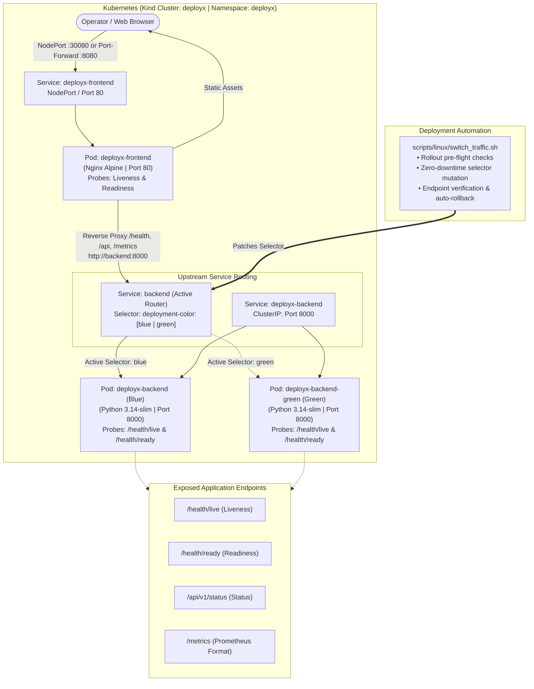

# DeployX – Intelligent Cloud Deployment & Disaster Recovery Platform

[](https://kubernetes.io/)
[](https://www.docker.com/)
[](https://kind.sigs.k8s.io/)
[](https://fastapi.tiangolo.com/)
[](https://prometheus.io/)
[](https://grafana.com/)
[](tests/)
[](LICENSE)

> **DeployX** is a modular cloud deployment and telemetry platform designed to demonstrate modern containerization, Kubernetes orchestration, and telemetry practices. The platform currently features a production-hardened FastAPI backend with health and readiness endpoints, Prometheus-format application metrics, a responsive HTML/CSS/JavaScript operations dashboard, containerization via Docker and Docker Compose, a local Kubernetes deployment using Kind with readiness and liveness probes, ClusterIP/NodePort Services, strict resource limits, and an automated Blue-Green deployment architecture with pre-flight rollout validation and automated script-level rollback. Centralized Prometheus/Grafana server stacks and continuous delivery automation are scheduled for upcoming phases.

---

## 🌟 Executive Summary

Modern cloud architectures demand continuous delivery without sacrificing reliability. DeployX bridges the gap between agile application delivery and high-availability operations through a disciplined, phased engineering approach.

### Implemented Functionality (Phases 0–5)
- **FastAPI Telemetry Backend:** Lightweight, asynchronous Python backend providing dedicated process liveness (`/health/live`), dependency readiness (`/health/ready`), system status (`/api/v1/status`), and structured JSON logging with request correlation IDs.
- **Prometheus-Format Application Metrics:** Live RED metrics (Rate, Errors, Duration) and uptime gauges exposed at `/metrics` using standard Prometheus exposition format.
- **Operations Center Dashboard:** Dark-themed, responsive single-page dashboard built with vanilla HTML5, CSS3, and modern JavaScript (ES6+), featuring live health indicators, request latency calculations, and route telemetry tables with zero Node.js build overhead.
- **Multi-Container Docker Architecture:** Hardened Debian slim backend container (`python:3.14-slim`) running as an unprivileged user (`deployx:10001`) and an ultra-lightweight Nginx Alpine frontend container (`nginx:alpine`) configured for Gzip compression and reverse-proxy caching controls.
- **Unified Docker Compose Orchestration:** Root-level `compose.yaml` with internal bridge networking (`deployx-network`), health check contracts, and deterministic startup sequencing (`depends_on: backend: condition: service_healthy`).
- **Kubernetes Deployment on Kind:** Declarative Kubernetes manifests (`infrastructure/kubernetes/`) deploying workloads into an isolated `deployx` namespace on a local Kind cluster (`deployx`).
- **Probes & Resource Discipline:** Configured Kubernetes liveness and readiness probes on both backend and frontend pods, with strict CPU and memory requests and limits (< 200 MiB total combined footprint).
- **Service Discovery & Compatibility:** ClusterIP backend service (`deployx-backend`), DNS alias service (`backend`) ensuring seamless Nginx reverse-proxy compatibility with Docker Compose, and NodePort frontend service (`30080`).
- **Zero-Downtime Blue-Green Deployment:** Dedicated Blue (`deployx-backend`) and Green (`deployx-backend-green`) Deployments paired with a dynamic routing Service (`backend`) that seamlessly directs upstream Nginx proxy traffic to either environment via service selector mutation (`deployment-color: blue|green`).
- **Automated Traffic Switching Controller:** Production-grade Bash controller (`scripts/linux/switch_traffic.sh`) with strict argument validation, target deployment rollout readiness verification, active endpoint polling, and automated rollback on endpoint failure.

### Planned Roadmap (Phases 6–11)
- **Dedicated Observability Stack (Phase 6):** Centralized Prometheus scrape server and provisioned Grafana dashboards for cluster and telemetry monitoring.
- **Cross-Platform Automation Tooling (Phase 7):** Automated operational scripts for Linux (Bash) and Windows (PowerShell).
- **CI/CD Pipeline Automation (Phase 8):** GitHub Actions workflows for continuous integration, linting, container builds, and test runs.
- **AWS Cloud Infrastructure as Code (Phase 9):** Terraform / CloudFormation infrastructure definitions for AWS VPC, EC2, S3 snapshot persistence, and CloudWatch.
- **Intelligent Diagnostics & Local LLM (Phase 10):** Kubernetes failure signature analysis with optional local Ollama integration.
- **Chaos Engineering & Resilience Validation (Phase 11):** Failure injection testing and end-to-end SLA verification.

---

## 🏗️ Architecture At A Glance



For complete technical specifications, see [ARCHITECTURE.md](ARCHITECTURE.md).

---

## 📂 Repository Directory Structure

```text
deployx/
├── .github/
│   └── workflows/              # GitHub Actions CI/CD pipelines
├── backend/                    # FastAPI application, health probes & telemetry
│   ├── app/
│   │   ├── api/                # API routers (health, status, metrics)
│   │   ├── core/               # Configuration, logging & security
│   │   ├── middleware/         # Correlation ID & request metrics tracking
│   │   └── services/           # Telemetry metrics & application state
│   ├── tests/                  # Pytest backend tests (20 tests passed)
│   ├── verify_endpoints.py     # Live HTTP verification harness
│   ├── requirements.txt        # Pinned dependencies
│   └── README.md               # Backend documentation & runbook
├── frontend/                   # Operations Center Dashboard (HTML5/CSS3/Vanilla JS)
│   ├── css/                    # Dark-themed responsive stylesheet
│   ├── js/                     # API client, Prometheus parser, charts, UI controller
│   ├── assets/                 # SVGs and icons
│   ├── test_api_parser.js      # Node.js Prometheus parser test
│   ├── verify_frontend_e2e.py  # End-to-end 10-point operational validation harness
│   └── README.md               # Frontend runbook & architecture
├── infrastructure/
│   ├── docker/                 # Production Dockerfiles & docker-compose.yml
│   ├── kubernetes/             # K8s manifests (Blue-Green Deployments, Services)
│   ├── monitoring/             # Prometheus scrape configs & Grafana dashboards
│   └── aws/                    # Terraform / CloudFormation IaC for AWS
├── scripts/
│   ├── linux/                  # switch_traffic.sh and Bash operational scripts
│   └── windows/                # PowerShell cross-platform automation scripts
├── tests/                      # Full integration test suites (frontend, docker, kubernetes, traffic)
├── docs/                       # Runbooks, diagrams & architecture documentation
├── .env.example                # Standardized environment configuration template
├── .gitignore                  # Security-first ignore rules
├── ARCHITECTURE.md             # Comprehensive architecture design document
├── ENVIRONMENT_AUDIT.md        # Host & cluster hardware audit report
├── TASK_STATUS.md              # Project milestone and phase tracker
└── README.md                   # Project overview & documentation
```

---

## 💻 Verified Local Environment

DeployX has been verified on the following hardware and software baseline:
- **Operating System:** Windows 11 with Ubuntu 26.04.1 LTS on WSL2
- **Docker Engine:** `29.9.2` (build `a82e528`)
- **Docker Compose:** `v5.6.1`
- **kubectl:** `v1.36.1` (Kustomize `v5.8.1`)
- **Kind:** `v0.30.0`
- **Helm:** `v3.22.1`
- **Python:** `3.14.4`
- **Kubernetes Cluster:** `deployx` (Kind context: `kind-deployx`, K8s: `v1.34.0`, Node: `deployx-control-plane`)
- **Memory Constraint:** ~3.5 GiB RAM allocated to WSL2 (active budget ~960 MiB total workload footprint)

See [ENVIRONMENT_AUDIT.md](ENVIRONMENT_AUDIT.md) for full audit data.

---

## 🚀 Quickstart & Roadmap

This project is structured into sequential delivery phases tracked in [TASK_STATUS.md](TASK_STATUS.md):

| Phase | Milestone | Status |
|---|---|---|
| **Phase 0** | Environment Audit & Architecture Design | ✅ **Completed** |
| **Phase 1** | Core FastAPI Backend & Health Telemetry Engine | ✅ **Completed (20/20 Tests Passed)** |
| **Phase 2** | Lightweight Frontend Dashboard | ✅ **Completed (28/28 Tests Passed)** |
| **Phase 3** | Docker & Compose Orchestration | ✅ **Completed (35/35 Tests Passed)** |
| **Phase 4** | Kubernetes Manifests & Kind Deployment | ✅ **Completed (40/40 Tests Passed)** |
| **Phase 5** | Blue-Green Deployment & Traffic Controller | ✅ **Completed (48/48 Tests Passed)** |
| **Phase 6** | Prometheus & Grafana Monitoring Stack | ⏳ Up Next |
| **Phase 7** | Linux & Windows Automation Tooling | ⏳ Planned |
| **Phase 8** | GitHub Actions CI/CD Pipeline | ⏳ Planned |
| **Phase 9** | AWS Cloud IaC (VPC, EC2, S3, CloudWatch) | ⏳ Planned |
| **Phase 10** | Intelligent Diagnostics & Local Ollama | ⏳ Planned |
| **Phase 11** | Chaos Engineering & Final Portfolio Review | ⏳ Planned |

---

## 🐳 Docker Orchestration Quickstart

DeployX provides a unified multi-container Docker Compose workflow:

```bash
# 1. Build production images (Backend: Python 3.14-slim, Frontend: Nginx Alpine)
docker compose build

# 2. Launch services in the background with healthcheck dependencies
docker compose up -d

# 3. Check health and running status
docker compose ps

# 4. View real-time logs
docker compose logs -f

# 5. Access the Operations Center Dashboard & Proxied Endpoints
# Frontend UI:             http://localhost:3000/
# Proxied Liveness:        http://localhost:3000/health/live
# Proxied Readiness:       http://localhost:3000/health/ready
# Proxied Status:          http://localhost:3000/api/v1/status
# Proxied Prometheus:      http://localhost:3000/metrics
# Proxied Swagger Docs:    http://localhost:3000/docs
# Direct Backend:          http://localhost:8000/health/live

# 6. Graceful shutdown
docker compose down
```

For in-depth container architecture details, see [infrastructure/docker/README.md](infrastructure/docker/README.md).

---

## ☸️ Kubernetes & Blue-Green Quickstart

DeployX runs natively on Kubernetes via Kind (`deployx` cluster, `deployx` namespace):

```bash
# 1. Load locally built container images into the Kind cluster
kind load docker-image deployx-backend:latest --name deployx
kind load docker-image deployx-frontend:latest --name deployx

# 2. Dry-run validate and apply manifests
kubectl apply --dry-run=client -f infrastructure/kubernetes/
kubectl apply -f infrastructure/kubernetes/

# 3. Check workload status and endpoints
kubectl get all,endpoints -n deployx

# 4. Port-forward the frontend service for local access
kubectl port-forward -n deployx svc/deployx-frontend 8080:80

# 5. Switch active traffic between Blue and Green environments
./scripts/linux/switch_traffic.sh green
./scripts/linux/switch_traffic.sh blue
```

For complete manifest specifications, probe details, and DNS alias architecture, see [infrastructure/kubernetes/README.md](infrastructure/kubernetes/README.md).

---

## 🔒 Security & Safe Operation Principles

- **Zero Hardcoded Secrets:** All secrets and credentials are strictly injected at runtime via environment variables or Kubernetes Secrets.
- **Zero Unsafe DOM Injection:** Dashboard strictly avoids `innerHTML` for dynamic payloads, using `textContent` and safe DOM elements to prevent XSS.
- **Non-Root Execution:** All workload containers execute as unprivileged users.
- **Fail-Safe Design:** Disaster recovery automation prioritizes service availability over speculative cutovers.
- **Resource Discipline:** Strict CPU and RAM limits on all containers prevent resource starvation in development and production alike.

---

## 📜 License & Acknowledgments

Licensed under the Apache License, Version 2.0. Developed as an enterprise-grade cloud engineering and DevOps portfolio project.
