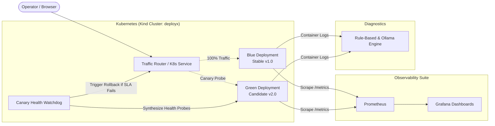

# DeployX – Intelligent Cloud Deployment & Disaster Recovery Platform

[](https://kubernetes.io/)
[](https://www.docker.com/)
[](https://kind.sigs.k8s.io/)
[](https://fastapi.tiangolo.com/)
[](https://prometheus.io/)
[](https://grafana.com/)
[](LICENSE)

> **DeployX** is a production-grade, portfolio-ready DevOps and Cloud Engineering platform showcasing automated zero-downtime Blue-Green deployments, synthetic canary health probing, automated disaster recovery rollbacks, full-stack observability, and cross-platform automation on Kubernetes and AWS.

---

## 🌟 Executive Summary

Modern cloud architectures demand continuous delivery without sacrificing reliability. DeployX bridges the gap between agile application delivery and high-availability disaster recovery by providing:
- **Zero-Downtime Blue-Green Cutover:** Seamless traffic migration between active and standby release environments.
- **Automated Disaster Recovery (DR) Rollback:** Instant detection of degraded latency or error spikes during releases, automatically reverting traffic to the stable release within seconds.
- **Micro-Footprint Engineering:** Engineered to operate completely within constrained development environments (~3.5 GiB RAM in WSL2/Docker) with zero paid cloud API dependencies.
- **Unified Observability:** Granular RED metrics (Rate, Errors, Duration) exported to Prometheus and visualized on real-time Grafana dashboards.
- **Intelligent Diagnostics:** Deterministic Kubernetes failure signature analysis (CrashLoopBackOff, OOMKilled) with optional local LLM integration via Ollama.
- **Cross-Platform Automation:** Complete parity with dual native automation suites for Linux (Bash) and Windows (PowerShell).

---

## 🏗️ Architecture At A Glance



For complete technical specifications, see [ARCHITECTURE.md](ARCHITECTURE.md).

---

## 📂 Repository Directory Structure

```text
deployx/
├── .github/
│   └── workflows/              # GitHub Actions CI/CD pipelines
├── backend/                    # FastAPI application, health probes & telemetry
│   ├── app/
│   │   ├── api/                # API routers (health, deployment, diagnostics)
│   │   ├── core/               # Configuration, logging & security
│   │   └── services/           # DR engine, canary checker & diagnostics
│   └── tests/                  # Pytest unit & integration tests
├── frontend/                   # Single-Page Dashboard (HTML5/CSS/Vanilla JS)
├── infrastructure/
│   ├── docker/                 # Production Dockerfiles & docker-compose.yml
│   ├── kubernetes/             # K8s manifests (Deployments, Services, ConfigMaps)
│   ├── monitoring/             # Prometheus scrape configs & Grafana dashboards
│   └── aws/                    # Terraform / CloudFormation IaC for AWS
├── scripts/
│   ├── linux/                  # Bash deployment, rollback & verification scripts
│   └── windows/                # PowerShell cross-platform automation scripts
├── tests/                      # End-to-end chaos & rollback test suites
├── docs/                       # Runbooks, diagrams & architecture documentation
├── .env.example                # Standardized environment configuration template
├── .gitignore                  # Security-first ignore rules
├── ARCHITECTURE.md             # Comprehensive architecture design document
├── ENVIRONMENT_AUDIT.md        # Host & cluster hardware audit report
├── TASK_STATUS.md              # Project milestone and phase tracker
└── README.md                   # Project overview & documentation
```

---

## 💻 Verified Local Environment

DeployX has been verified on the following hardware and software baseline:
- **Operating System:** Windows 11 with Ubuntu 26.04.1 LTS on WSL2
- **Docker Engine:** `29.9.2` (build `a82e528`)
- **Docker Compose:** `v5.6.1`
- **kubectl:** `v1.36.1` (Kustomize `v5.8.1`)
- **Kind:** `v0.30.0`
- **Helm:** `v3.22.1`
- **Kubernetes Cluster:** `deployx` (Kind context: `kind-deployx`, K8s: `v1.34.0`, Node: `deployx-control-plane`)
- **Memory Constraint:** ~3.5 GiB RAM allocated to WSL2 (active budget ~960 MiB total workload footprint)

See [ENVIRONMENT_AUDIT.md](ENVIRONMENT_AUDIT.md) for full audit data.

---

## 🚀 Quickstart & Roadmap

This project is structured into sequential delivery phases tracked in [TASK_STATUS.md](TASK_STATUS.md):

| Phase | Milestone | Status |
|---|---|---|
| **Phase 0** | Environment Audit & Architecture Design | ✅ **Completed** |
| **Phase 1** | Core FastAPI Backend & Health Probes | ⏳ Up Next |
| **Phase 2** | Lightweight Frontend Dashboard | ⏳ Planned |
| **Phase 3** | Docker & Compose Orchestration | ⏳ Planned |
| **Phase 4** | Kubernetes Manifests & Kind Deployment | ⏳ Planned |
| **Phase 5** | Blue-Green Deployment & Automated Rollback | ⏳ Planned |
| **Phase 6** | Prometheus & Grafana Monitoring Stack | ⏳ Planned |
| **Phase 7** | Linux & Windows Automation Tooling | ⏳ Planned |
| **Phase 8** | GitHub Actions CI/CD Pipeline | ⏳ Planned |
| **Phase 9** | AWS Cloud IaC (VPC, EC2, S3, CloudWatch) | ⏳ Planned |
| **Phase 10** | Intelligent Diagnostics & Local Ollama | ⏳ Planned |
| **Phase 11** | Chaos Engineering & Final Portfolio Review | ⏳ Planned |

---

## 🔒 Security & Safe Operation Principles

- **Zero Hardcoded Secrets:** All secrets and credentials are strictly injected at runtime via environment variables or Kubernetes Secrets.
- **Non-Root Execution:** All workload containers execute as unprivileged users.
- **Fail-Safe Design:** Disaster recovery automation prioritizes service availability over speculative cutovers.
- **Resource Discipline:** Strict CPU and RAM limits on all containers prevent resource starvation in development and production alike.

---

## 📜 License & Acknowledgments

Licensed under the Apache License, Version 2.0. Developed as an enterprise-grade cloud engineering and DevOps portfolio project.
