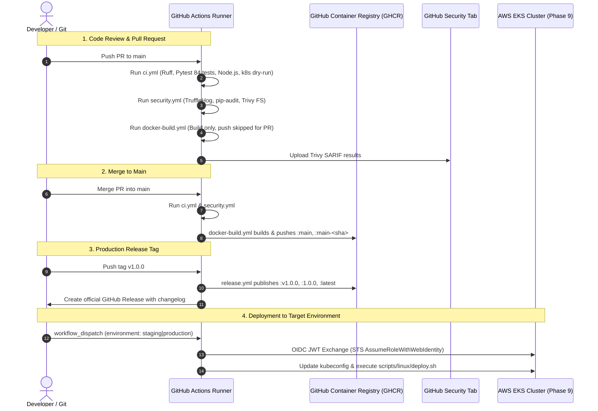

# DeployX — CI/CD Pipeline & GitHub Actions Runbook

This document details the configuration, security architecture, and operational procedures for DeployX's Continuous Integration and Continuous Delivery (CI/CD) pipelines implemented via GitHub Actions.

---

## 🎯 Objectives

The CI/CD subsystem achieves four core engineering objectives:
1. **Automated Quality Verification:** Continuous linting, syntax checking, unit and integration testing across Python, JavaScript, and Kubernetes manifests on every branch and pull request.
2. **Deterministic Artifact Building:** Multi-stage Docker image builds with layer caching (`type=gha`), creating secure, unprivileged container images for backend and frontend components.
3. **Continuous Security Auditing:** Integration of TruffleHog (secret leaks), pip-audit (CVE dependency auditing), and Trivy (filesystem and container image vulnerability scanning).
4. **Zero-Downtime Deployment Readiness:** Prepared CD workflows integrating with AWS EKS (Phase 9) via OIDC authentication, ensuring seamless execution of deployment and disaster recovery scripts without static cloud credentials.

---

## 🏗️ Workflow Architecture

DeployX maintains five modular workflows within `.github/workflows/`:

```
.github/
├── README.md
└── workflows/
    ├── ci.yml                 # Code linting, 84-test Pytest suite, frontend unit tests, manifest dry-runs
    ├── docker-build.yml       # Docker Buildx matrix build and push to GHCR with GHA layer caching
    ├── security.yml           # TruffleHog secret scanning, pip-audit, Trivy vulnerability scan
    ├── release.yml            # Semantic version release creation and immutable image tagging
    └── deploy.yml             # AWS EKS deployment skeleton with OIDC and automated scripts
```

### Event Flow & Trigger Model



---

## 🛡️ Security Guardrails & Compliance

| Security Gate | Implementation | Purpose |
|---|---|---|
| **Secret Scanning** | `trufflesecurity/trufflehog` | Detects accidentally committed API keys, tokens, or credentials across the git history. |
| **Dependency CVE Scan** | `pip-audit` via PyPA advisory DB | Scans Python requirements for known Common Vulnerabilities and Exposures. |
| **Container Image Scan** | `aquasecurity/trivy-action` | Scans container root filesystem for OS package and library vulnerabilities; publishes SARIF. |
| **Immutable Action Pinning** | 40-character SHA hash (`@11bd71...`) | Protects against compromised upstream action repositories and mutated tags. |
| **Least Privilege Tokens** | `permissions: contents: read` | Workflows operate read-only by default; write permissions are isolated to specific jobs. |
| **Untrusted PR Isolation** | `push: ${{ github.event_name != 'pull_request' }}` | Prevents untrusted external pull requests from publishing images to GHCR. |
| **Zero Long-Lived Keys** | AWS OIDC Federation (`id-token: write`) | Eliminates hardcoded AWS access keys by utilizing temporary STS web identity tokens. |

---

## 📦 Container Registry Specifications

### Registry URL
```
ghcr.io/<github-owner>/<image-name>:<tag>
```

### Published Images
1. **Backend Service:** `ghcr.io/${{ github.repository_owner }}/deployx-backend`
2. **Frontend Service:** `ghcr.io/${{ github.repository_owner }}/deployx-frontend`

### Tagging Convention
- **Mainline Commits:** `:main`, `:main-<short_sha>` (e.g. `ghcr.io/org/deployx-backend:main-a16e422`)
- **Production Releases:** `:v1.0.0`, `:1.0.0`, `:latest`
- **Feature Branches:** `:pr-<pr_number>` (build validated, not pushed)

---

## 🧪 Local Test & Audit Commands

Developers can run these commands locally to ensure complete CI parity:

```bash
# Linting & Formatting
ruff check backend/ tests/ frontend/
ruff format --check backend/ tests/ frontend/
git diff --check

# Test Suite (84 Tests)
pytest -v backend/tests/ tests/

# Frontend Unit Tests
node frontend/test_api_parser.js
node frontend/test_navigation.js

# Kubernetes Manifest Dry-Runs
kubectl apply --dry-run=client -f infrastructure/kubernetes/
kubectl apply --dry-run=client -f infrastructure/monitoring/

# Dependency CVE Audit
pip-audit -r backend/requirements.txt
```
